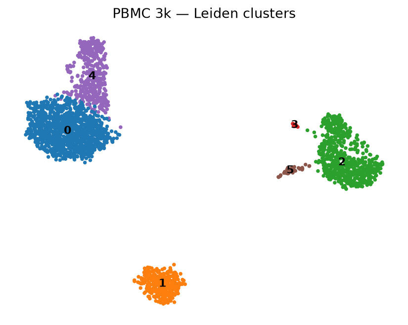
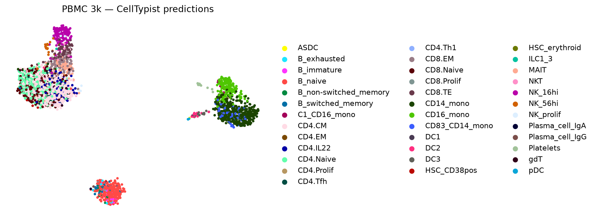
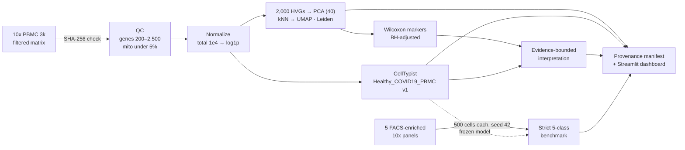
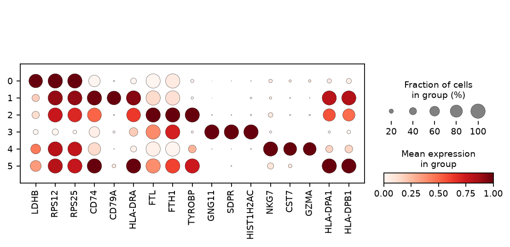
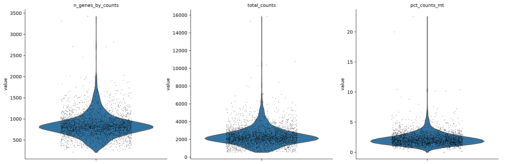
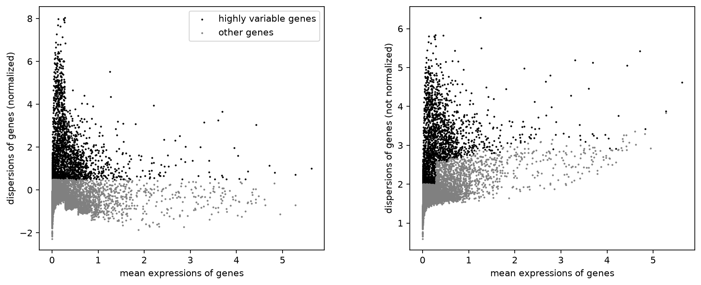
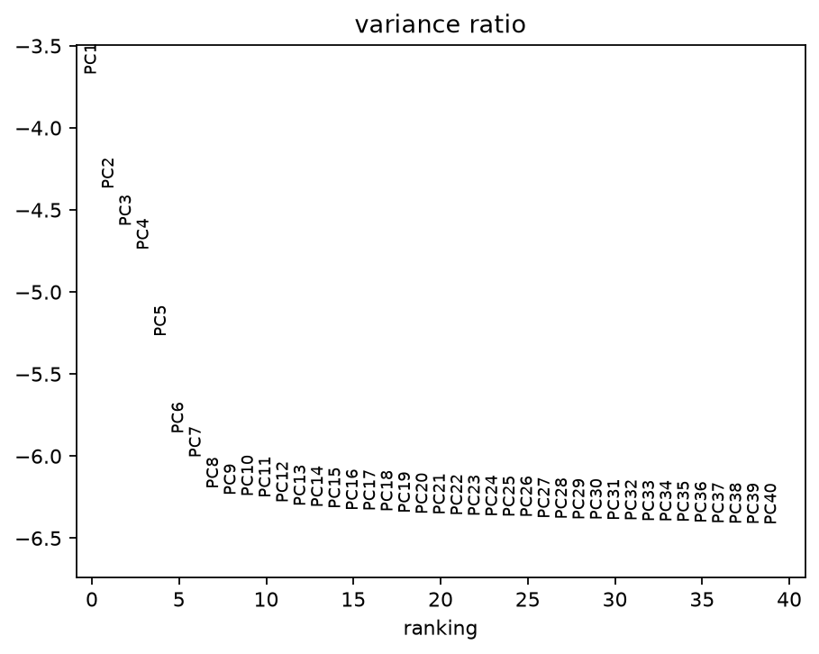
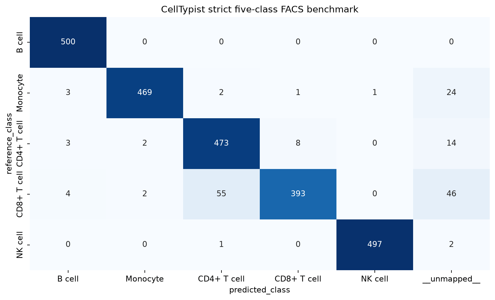

# CellPilot AI

**Reproducible single-cell RNA-seq analysis, reference-based cell annotation, and independent benchmarking on public 10x Genomics PBMC data.**


CellPilot AI takes a public 10x Genomics count matrix from checksum-verified download to QC, clustering, marker discovery, CellTypist annotation, evidence-bounded interpretation, and a strict benchmark against FACS-enriched reference populations. Every run writes a hash-verified provenance manifest, and a read-only Streamlit dashboard displays the saved results.

<p align="center">
  
  
</p>

## Key results

| | Result |
| --- | --- |
| **Input** | 10x PBMC 3k: **2,700 cells** × 32,738 genes (archive SHA-256 verified) |
| **After QC** | **2,638 cells** × 13,656 genes retained (62 cells removed) |
| **Analysis** | 2,000 HVGs · 40 PCs · 6 Leiden clusters · fixed seed 42 |
| **Annotation** | 2,638 per-cell CellTypist predictions; 81.85% model-feature overlap |
| **Benchmark** | **5-class FACS-enriched panel, 2,500 cells:** **93.28% strict accuracy**, **0.9478 macro-F1**, 0.9184 MCC |
| **Engineering** | CLI pipeline, Streamlit dashboard (7 pages), **58 automated tests passing** |
| **Integrity** | Manifest re-verification: 9 inputs + 37 outputs rehashed, zero issues |

All numbers come from the committed evidence in [`evidence/`](evidence/) for verified source revision `2c7ba636` (tag [`v0.1.0-verified`](../../tree/v0.1.0-verified)).

## Scientific objective

Reference-based annotation tools such as CellTypist are widely used, but their labels are often reported without an independent check. CellPilot AI asks two questions:

1. Can a fully scripted, seed-fixed Scanpy workflow reproduce a standard PBMC analysis with complete provenance for every input and output?
2. How accurately does a frozen CellTypist model recover **broad immune lineages** on cells whose identity was set independently by FACS enrichment, scored strictly so that unmapped predictions count as errors?

## Workflow architecture



| Stage | Module | What it does |
| --- | --- | --- |
| Acquire & validate | `data.py` | Downloads public archives, verifies SHA-256, checks integer UMI counts |
| Analysis | `pipeline.py` | QC, normalization (exactly once), HVGs, PCA, UMAP, Leiden; keeps raw counts in `layers["counts"]` |
| Markers | `markers.py` | Wilcoxon rank-sum on full-gene log-normalized `.raw`, Benjamini–Hochberg correction |
| Annotation | `annotation.py` | Checksum-verified CellTypist model; checks normalization and feature overlap; majority voting off, no fallback labels |
| Interpretation | `interpretation.py` | Deterministic backend by default; optional OpenAI structured output, locally rejected if labels or evidence IDs are unsupported |
| Benchmark | `benchmark.py` | Reference labels kept outside the AnnData passed to the model; frozen 51→5 label map; strict metrics |
| Provenance | `provenance.py` | Run manifest with hashes for all inputs/outputs, stage status, execution history, `verify` command |
| Dashboard | `dashboard.py` | Read-only Streamlit viewer over saved artifacts |

## Results

### Clustering and markers

Six Leiden clusters were recovered from 2,638 cells. Canonical lineage markers separate T/NK, B, and myeloid compartments.

<p align="center">
  
</p>

| Cluster | Cells | CellTypist majority label (fraction) | Interpretation (confidence) |
| ---: | ---: | --- | --- |
| 0 | 1,190 | CD4.CM (0.46) | Unresolved (low): no unique broad label supported |
| 1 | 341 | B_naive (0.79) | B_naive (moderate) |
| 2 | 640 | CD14_mono (0.62) | CD14_mono (moderate) |
| 3 | 12 | Platelets (1.00) | Platelets (moderate) |
| 4 | 419 | NK_16hi (0.34) | NK cell (low; NKG7, GNLY, PRF1, GZMB) |
| 5 | 36 | DC2 (0.47) | Dendritic cell (low; FCER1A, CST3, HLA-DRA) |

Cluster 0 is deliberately left **unresolved**. The interpretation layer does not assign a label unless the cited evidence supports it.

<details>
<summary>QC, feature selection, and PCA diagnostics</summary>

<p align="center">
  
  
  
</p>
</details>

### Independent five-class FACS benchmark

The frozen CellTypist model was applied to **2,500 cells**: 500 sampled (seed 42) from each of five official 10x FACS-enriched PBMC libraries (B cells, CD14⁺ monocytes, CD4⁺ helper T, CD8⁺ cytotoxic T, CD56⁺ NK). All 51 fine-grained model labels were mapped to the five broad classes **before** scoring, and predictions outside the mapping were counted as errors.

<p align="center">
  
</p>

| Metric | Value |
| --- | ---: |
| Strict accuracy | **0.9328** |
| Strict macro-F1 | **0.9478** |
| Strict balanced accuracy | 0.9328 |
| Matthews correlation coefficient | 0.9184 |
| Coverage (mapped / total) | 0.9656 (2,414 / 2,500) |
| CellTypist inference time (annotator call only) | 1.06 s |

| Reference class | Precision | Recall | F1 |
| --- | ---: | ---: | ---: |
| B cell | 0.980 | 1.000 | 0.990 |
| Monocyte | 0.992 | 0.938 | 0.964 |
| CD4⁺ T cell | 0.891 | 0.946 | 0.918 |
| CD8⁺ T cell | 0.978 | 0.786 | 0.871 |
| NK cell | 0.998 | 0.994 | 0.996 |

**Main error mode:** CD8⁺ T cells. 55 of 500 were predicted as CD4⁺, and 46 received labels outside the five-class mapping. This is a known difficulty for transcriptome-only CD4/CD8 separation.

Full outputs: [`evidence/benchmark/`](evidence/benchmark/) · method details: [`PROJECT_REPORT.md`](PROJECT_REPORT.md#independent-five-class-benchmark)

## Scientific limitations

These results are descriptive and scoped. Please read [`SCIENTIFIC_LIMITATIONS.md`](SCIENTIFIC_LIMITATIONS.md) before reusing them.

- **Benchmark confounding.** Each class comes from a separate library and possibly a separate donor, so class identity is confounded with batch and donor. The metrics do **not** measure donor-level generalization.
- **Imperfect ground truth.** FACS-enriched panels report 92–100% purity; these are enriched-population labels, not per-cell truth.
- **Broad lineages only.** The benchmark covers five classes and does not test fine-subtype accuracy (e.g., CD4 memory subsets, DC subtypes).
- **Single-donor demonstration.** PBMC 3k is one healthy donor and a Cell Ranger filtered matrix. Ambient RNA, doublets, batch, and condition effects are not modeled.
- **Interpretations are hypotheses.** Cluster labels need orthogonal biological validation. The optional LLM backend is covered by mocked tests only; no live API result is claimed.
- **No independent scientific audit yet.** The final skeptical review of the implementation has not been performed.
- **Platform scope.** The exact lock file is for Python 3.12 on macOS. Other OSes, containers, and clean-machine reproduction are untested.

This is an alpha research project. It is not a clinical or production tool.

## Data provenance

| Resource | Source | Integrity |
| --- | --- | --- |
| PBMC 3k (filtered matrix, hg19) | [10x Genomics](https://www.10xgenomics.com/datasets/3-k-pbm-cs-from-a-healthy-donor-1-standard-1-0-0), CC BY 4.0 | SHA-256 `847d6ebd…dc28b5` |
| 5 FACS-enriched PBMC panels | 10x Genomics (Zheng et al., 2017 public datasets) | Per-archive SHA-256 in [`data_manifest.json`](evidence/benchmark/data_manifest.json) |
| CellTypist `Healthy_COVID19_PBMC.pkl` v1 | [CellTypist model registry](https://www.celltypist.org/models); [Stephenson et al., 2021](https://doi.org/10.1038/s41591-021-01329-2) | SHA-256 `1eee68d2…6b3b79` |

No raw data, processed matrices, or model files are committed. All are downloaded and verified at run time. The run manifest, execution history, and stage status are in [`evidence/provenance/`](evidence/provenance/).

## Reproduce the results

**Requirements:** Python 3.12 (verified with CPython 3.12.5). No API key is needed.

```bash
git clone https://github.com/KatharineZhu/cellpilot-ai.git
cd cellpilot-ai

python3.12 -m venv .venv
.venv/bin/python -m pip install --upgrade pip
.venv/bin/python -m pip install '.[ai,test]'      # or: -r requirements-lock-py312-macos.txt, then --no-deps .
.venv/bin/python -m pip check
```

Use a regular install, not an editable one. See [`docs/USAGE.md`](docs/USAGE.md) for why.

```bash
# 1. PBMC 3k analysis + annotation + interpretation
.venv/bin/cellpilot fetch --config configs/pbmc3k.yaml
.venv/bin/cellpilot all   --config configs/pbmc3k.yaml --run-dir results/pbmc3k/verified_run

# 2. Five-class FACS benchmark
.venv/bin/cellpilot benchmark --config configs/benchmark.yaml --run-dir results/pbmc3k/verified_run

# 3. Re-verify every recorded input/output hash
.venv/bin/cellpilot verify --run-dir results/pbmc3k/verified_run

# 4. Tests
MPLCONFIGDIR=work/cache/matplotlib NUMBA_CACHE_DIR=work/cache/numba \
  .venv/bin/python -m pytest -q

# 5. Dashboard (read-only, serves saved artifacts)
CELLPILOT_RUN_DIR=results/pbmc3k/verified_run \
  .venv/bin/streamlit run src/cellpilot/dashboard.py
```

The tests cover count validation, normalization and count-layer preservation, CellTypist input and model checks, evidence validation, manifest tamper detection, benchmark label isolation, and all seven dashboard pages. A step-by-step walkthrough is in [`DEMO_GUIDE.md`](DEMO_GUIDE.md).

## Technology stack

**Analysis:** Python 3.12 · Scanpy · AnnData · CellTypist · NumPy · SciPy · pandas · scikit-learn<br>
**Visualization & app:** Matplotlib · Seaborn · Streamlit<br>
**Reliability:** Pydantic schemas · YAML configs · SHA-256 provenance manifests · pytest (58 tests)<br>
**Optional AI:** OpenAI Responses API structured output with local evidence validation

## Repository structure

```text
cellpilot-ai/
├── src/cellpilot/            # pipeline, annotation, benchmark, interpretation, provenance, dashboard, CLI
│   └── resources/            # marker evidence registry, frozen benchmark label map
├── configs/                  # pbmc3k.yaml, benchmark.yaml (all parameters + checksums)
├── tests/                    # 58 unit and integration-style tests
├── evidence/                 # committed metrics, tables, and provenance from the verified run
├── docs/
│   ├── figures/              # UMAP, marker, QC, PCA, and benchmark figures from the verified run
│   ├── USAGE.md              # detailed technical usage guide
│   └── BUILD_REPORT.md       # build/run/test report for the verified revision
├── PROJECT_REPORT.md         # methods and measured results
├── SCIENTIFIC_LIMITATIONS.md # scope, failure modes, untested claims
├── DEMO_GUIDE.md             # reproduction and demo walkthrough
├── requirements-lock-py312-macos.txt
└── pyproject.toml
```

`data/` and `results/` are created at run time and are excluded by `.gitignore`.

## References

- Zheng, G. X. Y. et al. Massively parallel digital transcriptional profiling of single cells. *Nat. Commun.* 8, 14049 (2017). https://doi.org/10.1038/ncomms14049
- Wolf, F. A., Angerer, P. & Theis, F. J. SCANPY: large-scale single-cell gene expression data analysis. *Genome Biol.* 19, 15 (2018). https://doi.org/10.1186/s13059-017-1382-0
- Domínguez Conde, C. et al. Cross-tissue immune cell analysis reveals tissue-specific features in humans. *Science* 376, eabl5197 (2022). https://doi.org/10.1126/science.abl5197
- Stephenson, E. et al. Single-cell multi-omics analysis of the immune response in COVID-19. *Nat. Med.* 27, 904–916 (2021). https://doi.org/10.1038/s41591-021-01329-2

## Author

**Jianxi Zhu**. Released under the [MIT License](LICENSE).
